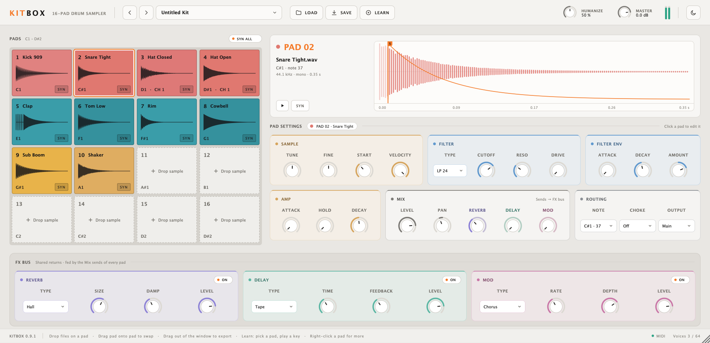
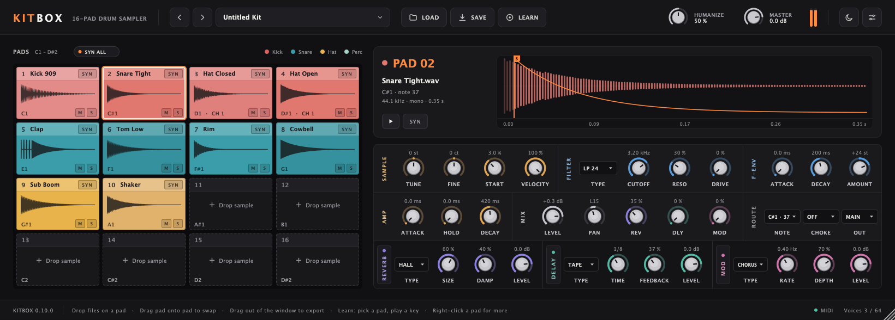

# Kitbox

A 16-pad drum sampler for macOS - AU (aumu/Ktbx/Tzor), VST3 and a standalone app, built with JUCE 9.

Its sibling [Transmute](https://github.com/TZorr/Transmute) rebuilds recorded
drum hits as clean synth voices and hands a whole kit over in one step:
**Export Kitbox Kit…** writes every drum onto its own Kitbox pad, with pan and
notes. Since 0.7.0 its engine is in Kitbox too: each pad plays its sample or
Transmute's synth of it.

Family: [Rackbox](https://github.com/TZorr/Rackbox) (four-slot multi-effect), [Rackbox Plus](https://github.com/TZorr/RackboxPlus) (the same rack, eight knobs per effect), [FMBox](https://github.com/TZorr/FMBox) (eight-sound FM drum synth), [Chordbox](https://github.com/TZorr/Chordbox) (16-pad chord generator), [Transmute](https://github.com/TZorr/Transmute) (drum resynthesis), [Clearbox](https://github.com/TZorr/Clearbox) (target-curve dynamic EQ).

## Panel

Since 0.10.0 the panel follows the compact design "Variante B": laid out at
1640 x 588, it scales as a whole - drag the window's corner, at a fixed
aspect ratio, from 60 to 140 %, or pick a size under the settings button. It
opens at 85 % the first time and remembers the size.

- **Header:** the kit browser (< > and the kit field, the kit's folder framed
  after its name), Load, Save, Learn, Humanize and Master with the output
  meter, and on the right the light / dark switch and the settings menu
  (window size, presets folder). Theme and size are yours, not the kit's -
  every Kitbox window and project opens the way you left it.
- **Pads:** number and name in a lighter bar, SYN at its end; **M** and
  **S** (Mute, Solo) bottom right. A muted pad - or, while any pad is
  soloed, every pad that is not - plays nothing and is drawn at half
  strength; what it still had ringing fades out in 5 ms. Mute and Solo are
  saved with the kit and can be automated.
- **Control rack:** one panel under the sample display, three rows - Sample,
  Filter, Filter Env; Amp, Mix, Routing; and the FX bus - each section named
  down its left edge.
- **Knobs** are light metal caps in a coloured ring: the value above, the
  name below. The value lights up while the mouse is over a knob or turns
  it, and for a second after; automation leaves it dim.
- **Colour zones:** the rings say what a knob works on - amber for the sound
  (Sample, Amp), blue for the filter, grey for Mix and Routing, and each
  send in its effect's colour, as on the FX bus. With the filter Off its
  knobs fade back.
- **FX bus:** each effect's upright name is its ON / OFF; off, its controls
  fade.
- **Footer:** MIDI light and the voices sounding.

## Install

Download `Kitbox.0.10.0.pkg` from
[Releases](https://github.com/TZorr/Kitbox/releases) and run it; choose AU,
VST3 or both - they go into `/Library/Audio/Plug-Ins`. Apple Silicon, macOS
26.5 or later. The installer is unsigned, so Gatekeeper refuses it at first:
right-click it and choose Open, or allow it under System Settings › Privacy &
Security.

**Demo kit:** [`Kits/Transmute Kit.kitbox`](Kits/Transmute%20Kit.kitbox)
(also attached to the release) - sixteen DMX drum samples, turned into
Transmute synths right in Kitbox with **SYN ALL**; each pad's **SYN** plays
the original or the synth. Open it with **Load Kit**.

## Signal path

    pad sample (summed to mono on load)
      -> pitch (Tune, Fine; resampled on the fly, 4-point Hermite)
      -> filter: TPT state-variable, LP 12/24, BP, HP 12/24, with Drive and
         a saturating resonance; filter envelope (Attack, Decay, Amount)
      -> amp envelope (Attack, Hold, Decay; Decay "Full" = play the sample out)
      -> Level / Pan (equal power)  -> stereo mix
      -> Reverb / Delay / Mod sends (mono, post-level, pre-pan)

    Three send slots with Rackbox's effects (copied into Source/Engine/Fx),
    each knob-selectable by Type; a mono send enters as a centred stereo
    signal and returns in stereo:

    Reverb   Plate / Room / Hall                     Size, Damp
    Delay    Digital / Tape / Ping-Pong, tempo-synced Time (note value), Feedback
    Mod      Chorus / Phaser / Flanger / Tremolo     Rate, Depth
             Shifter (frequency shifter, 0.3.0)      Shift, Feedback

    Switching Type crossfades over 30 ms. Kits saved before 0.2.0 are
    translated on load (Source/Engine/FxMigration.h).

64 voices, 48 sounding; a stolen voice fades over 2 ms. Hits are one-shots and
sample-accurate.

## Routing (per pad)

- **Note** - any MIDI note; default 36-51 (C1-D#2). Several pads on one note
  play together (layering). **Learn Note**: select a pad, press the button,
  play a key.
- **Choke** - groups 1-8. A hit fades every voice in its group over 5 ms, the
  pad's own included (an open hat chokes itself). Pads layered on one note in
  the same group do not choke each other.
- **Output** - Main or Out 1-16. The plugin has sixteen stereo aux outputs,
  off by default; use Logic's *Multi Output* variant (or enable outputs in
  your DAW). A pad routed to an output that is not enabled plays on Main.
  Effect returns always go to Main; Master scales every output.

Dragging one pad onto another swaps sample, knobs, choke and output - the
note stays with the pad's place.

**Humanize** (0-100 %, 50 % at start) varies every hit by up to pitch +-6 ct,
filter +-10 %, level +-2 dB, start +-1 ms and pan +-4 % at 100 %; 50 % is what
100 % was before 0.6.0 (+-3 ct, 5 %, 1 dB, 0.5 ms, 2 %), and kits and sessions
saved before then load with their Humanize halved, so they sound as they did.

## Pads

- Click to play (higher on the pad = louder), right-click to load, rename or
  clear, to choose Sample, Auto or a Transmute model (see below), or to
  **Colour** the pad: twelve colours, Custom..., or Default (its group's).
  The colour is saved with the kit and moves with the pad when it is swapped.
- **Rename...** renames the pad's sample: the name is saved with the kit and
  the session, moves with the pad when it is swapped, and is the file name a
  drag out of the pad hands over (the extension stays).
- Drop audio files on a pad; several files fill the following pads in name order.
- Drag a pad onto another to swap them (sample and knobs).
- **Export Samples...** (right-click, any pad) writes the whole kit's files
  into a new folder: `Original/` with every pad's sample as it came, `Synth/`
  with every synth and its `.drumparams`, named `01 Kick 01.wav` and so on,
  as inside the kit container.
- Drag a pad out of the window to hand its file to the Finder or a DAW - the
  sample, or the synth when the pad plays one.

## Transmute

Kitbox carries [Transmute](https://github.com/TZorr/Transmute)'s engine: the
analysis that measures a recorded hit, the fit that rebuilds it from a small
synth voice, and the synth itself - ported to C++ and held against the Swift
original, which it matches bit for bit on Transmute's 24 test samples
(analysis, fit and render; see `Verification/TransmuteCheck.cpp`). No knobs
for it: Transmute's sliders stay in Transmute.

- **Right-click a pad** and choose what it plays: **Sample**, **Auto** (the
  model the hit suggests, named once it has been analysed), or one of the five
  models - **Kick / Tom**, **Snare**, **Hi-Hat**, **Modal**, **Clap**.
- **SYN**, bottom right on each pad (and beside the play button in the
  display), switches it between its sample and its synth with one click (back
  to the model chosen last, Auto otherwise). It is lit once the synth plays.
- **SYN ALL**, beside PADS, sets every pad that holds a sample to Auto, once.
- A pad plays its sample until its fit is in (one to four seconds, several
  pads at once), then the synth; the display says `fitting... 40 %`, with a
  bar crossing the waveform as far as the fit has got, then `synth Snare`. Back to Sample and again to the same model switch at once.
- The synth is rendered at the sample's own rate, as Transmute exports, and
  every Kitbox knob acts on it as on any sample. A new sample dropped on a pad
  set to Auto or a model is fitted in turn.
- Up to 10 seconds, Transmute's limit for a single hit; longer samples stay
  samples.

## Kits

**Save Kit / Load Kit** write and read Kitbox kits (`.kitbox`). The dialogs open in
`~/Library/Audio/Presets/T'Zorr/Kitbox/`, which Kitbox creates itself. Should that
fail, they open in Logic's settings folder for Kitbox,
`~/Music/Audio Music Apps/Plug-In Settings/Kitbox/`. The kit is named after the file, without extension.

The **kit browser** in the header mirrors that folder: the kit field's menu has
a submenu per folder, the field shows `Folder › Kit`, and **< >** step through
the kits of the loaded kit's folder, round from its end to its start. The
session remembers the kit's file, so the arrows go on in the right folder
after a project is reopened.
A kit holds every pad's original sample file plus all settings, and the DAW
session stores the same container, so a project never depends on where the
samples were. Since 0.7.0 it is a plain ZIP: rename it to `.zip` (or `unzip`
it) to get at the samples. Since 0.8.0 `.kitbox` is the only kit format; Logic
keeps its own `.aupreset` settings in its own menu.

    kit.xml                        every knob, each pad's Sample/Auto/model choice
    Original/01 Kick 01.wav        each pad's sample, the file as it came
    Synth/01 Kick 01.wav           its Transmute synth (24-bit, or 32-bit float above 0 dBFS)
    Synth/01 Kick 01.drumparams    the synth's parameters - opens in Transmute

The two digits are the pad. At most 16 originals and 16 synths. Kits and
sessions from before 0.7.0, and the kits Transmute's *Export Kitbox Kit*
writes, still load.

## Building

    Scripts/build.sh     # Release build + KitboxCheck + EditorShot (panel PNG in build/shots)
    Scripts/install.sh   # installs to /Library/Audio/Plug-Ins (sudo), runs auval
    Scripts/package.sh   # build + checks, then the AU/VST3 installer in build/

JUCE is expected at `~/JUCE`. No AUv3 on purpose - see the note in `CMakeLists.txt`.

## Licence

Kitbox is © 2026 T'Zorr and is distributed under AGPLv3 - see
[LICENSE](LICENSE). This follows from linking JUCE's free tier, which is
AGPLv3 itself; details in [THIRD_PARTY_NOTICES.md](THIRD_PARTY_NOTICES.md).

## Contact

T'Zorr - <TZorr@gmx.de>
